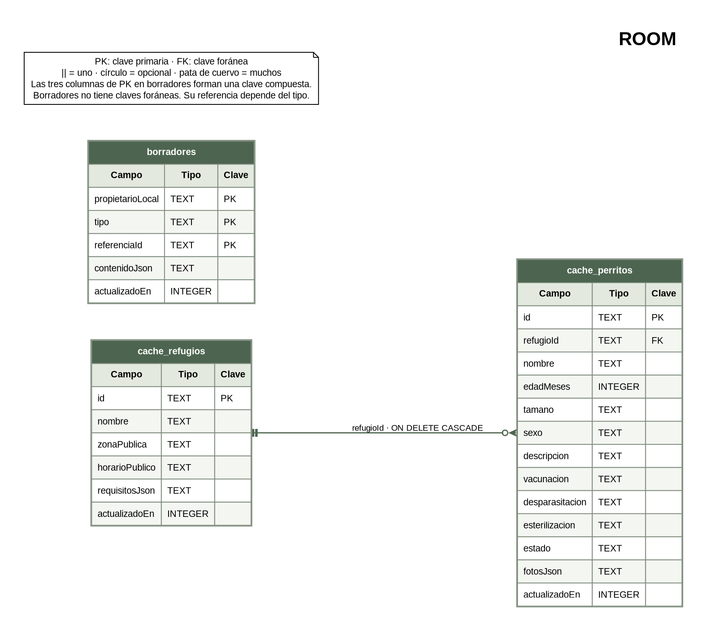

# Huellitas Chalco

## Instalación

1. Copia `Huellitas_Chalco_1.5.1.apk` a tu teléfono o tableta con Android 7.0 o superior.
2. Abre el APK y permite instalar desde esa aplicación de archivos si Android lo solicita.
3. Pulsa **Instalar**. Si ya tienes la app, instálalo como actualización sin desinstalarla.
4. Abre **Huellitas Chalco** con conexión a internet. Puedes explorar sin cuenta; inicia sesión para enviar solicitudes o administrar tu refugio autorizado.

## Modelos ER

### Firebase

### Room

